<h1 align="center">Compartments</h1>

<p align="center">
  <strong>A work, order and team-management platform</strong><br>
  <em>Built for a medical-equipment company to run its contracts, track every document and deadline, and follow the daily work of its team — in one clean, responsive workspace.</em>
</p>

<p align="center">
  <sub>Private project — source code not published. Screenshots use demo data only.</sub>
</p>

---

## About the client

The application was built for FASO IMB (Industry and Medical Business), a company based in Ouagadougou, Burkina Faso. FASO IMB supplies medical and biomedical equipment, devices and consumables, and maintains them, carrying out national and international contracts for public, state and private clients.

Every design choice follows that reality: running many contracts in parallel, tracking the exact documents and steps each one needs, and following the daily work of the team.

---

## User roles

The platform is organised around a clear, three-level hierarchy. Each account is individual, and a first login forces the user to replace a one-time provisional password.

- **General Manager (DG).** Full control: creates accounts, orders, protocols and tasks; reads every work log; approves proposals; sees the audit trail.
- **Director.** A team lead the DG puts in charge of selected employees — assigns and approves *their* tasks, while keeping their own.
- **Employee (Agent).** Works on orders and sections, keeps a daily work log, and updates the status of their own tasks.

---

## Orders and protocols

An order represents a contract — the supply of medical equipment, consumables, or a maintenance service for a client.

When the manager creates an order, it is given a number automatically and records the client, the country, the nature (product or service), the execution mode (public or private contract), the person responsible and, if needed, a team. A separate **personal order** is also available for a file the manager alone needs to follow: it has no responsible person and no team, and it never appears in anyone else's list.

Each order carries a **protocol** — a control checklist that makes sure every required document and step has been handled. Every item has a status (to do, in progress, done, or not applicable, the last one requiring a reason), and a progress bar at the top is computed automatically from the protocol. Recurring contracts can start from a **protocol template** so the right checklist is already in place. From the order's general view, the manager can rename it, change the person responsible or the team, and finish, cancel or reopen it.

---

## Sections and the activity feed

Inside an order, the real day-to-day work lives in **sections**, each with its own members. Every section has a single dated **feed** that keeps all of its progress in one place, in chronological order. Four kinds of entries can be added to a feed:

- **Message** — a short written update, such as a note on the customs file.
- **File** — a document dropped straight into the feed (PDF, image, Word, Excel or text, up to 10 MB each).
- **Table** — a simple columns-and-rows table, for example a carrier and a date.
- **Deadline** — a date to meet, with an alert when it approaches or passes. Only the manager can create, change or reopen a deadline; a member can mark it as done.

---

## Tasks and the work log

A **task** is a precise action given to an employee with a deadline — organising a transport, checking the calibration of a device, and so on. The manager (or a director) sets a title, an optional description, the deadline and, if useful, how long before the deadline the alert should fire. Tasks are shown with a colour code: grey for to-do, yellow for in progress, red for overdue, and green for done. The employee can change only the status of their own tasks.

An employee can also **propose** a task. The proposal goes to their director, or directly to the general manager, who accepts it (it becomes a real task) or refuses it with a short note.

Each employee keeps a **work log**: a calendar where they write a report for each working day. The manager can read any day and add a separate appraisal, without changing what the employee wrote.

---

## Alerts, notifications and audit

A single "to handle" view gathers everything that needs the manager's action: deadlines that are near or overdue, and tasks or proposals waiting for approval. Next to it, a **notifications** history keeps a record of everything that was signalled — messages, tasks, deadlines — with an unread counter, and nothing disappears from it once handled.

An **audit log** records every important action on tasks and work logs, with the date, the person and the change (old value to new value). Employees' private personal sections never appear in it.

---

## Exports

The full dossier of an order — protocol, sections and deadlines — can be downloaded as a PDF in one click. The same is true for an employee's task list, a work log, and the audit log, each exported exactly as filtered on screen.

---

## Screenshots

### Login
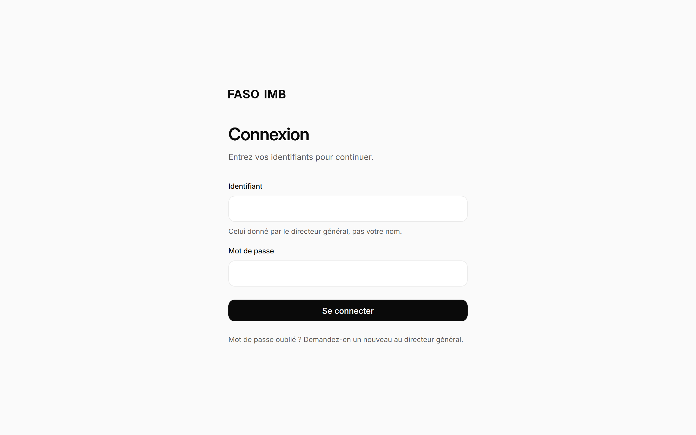

### Dashboard — light and dark theme
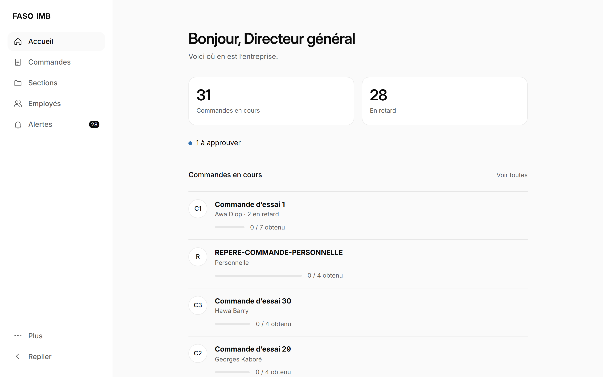
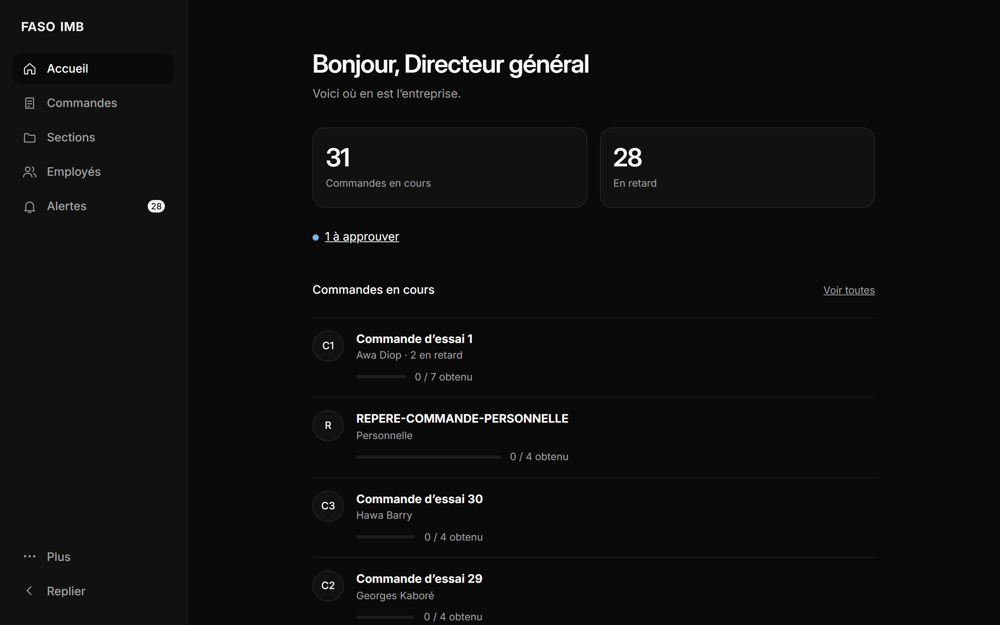

### Orders list
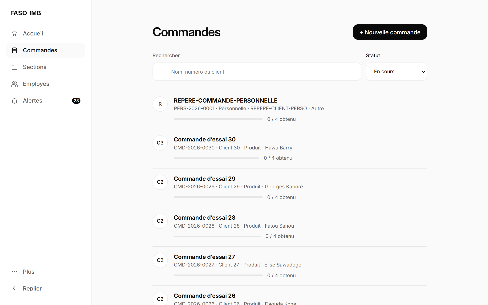

### Order detail and protocol checklist
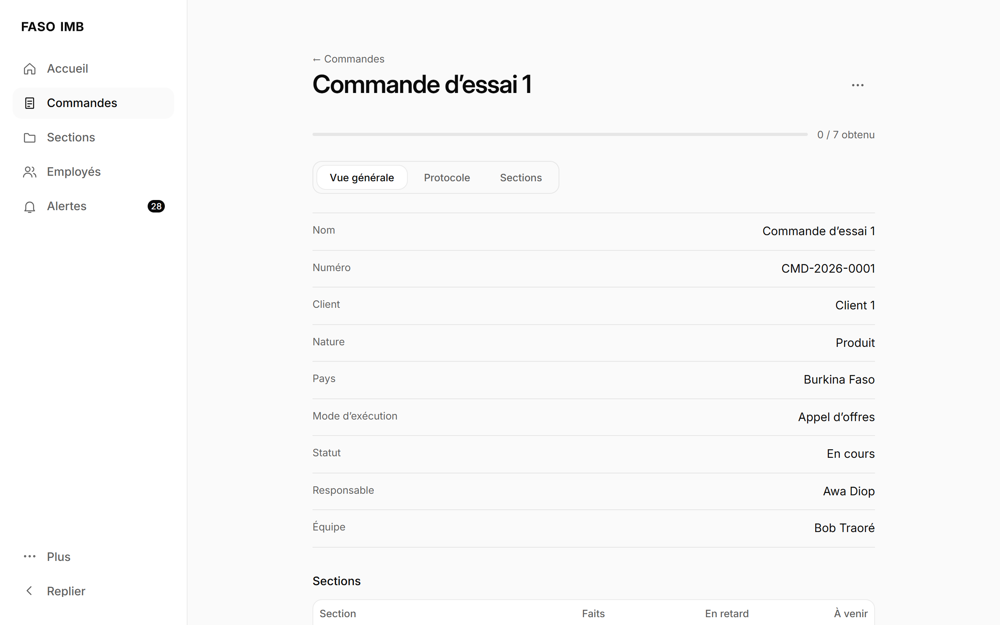

### Sections
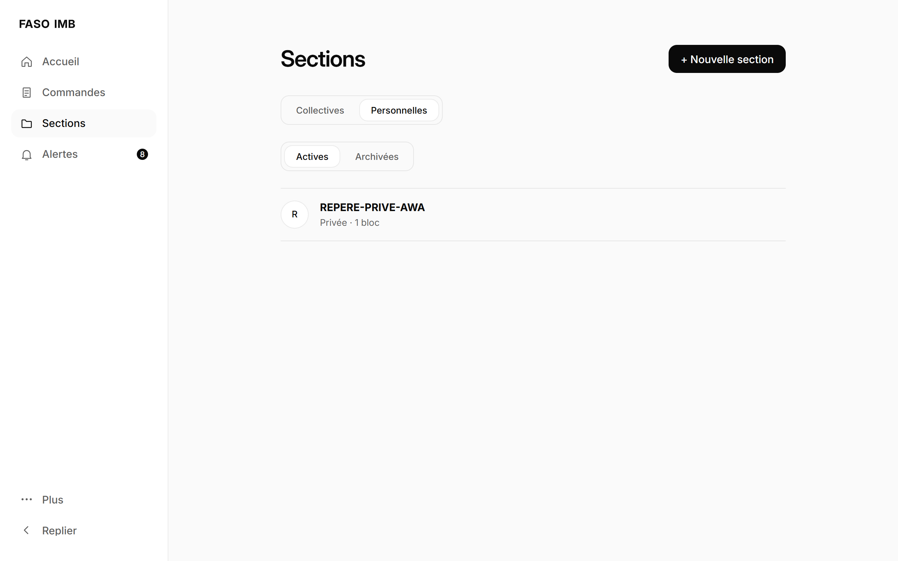

### Section feed (messages, files, tables, deadlines)
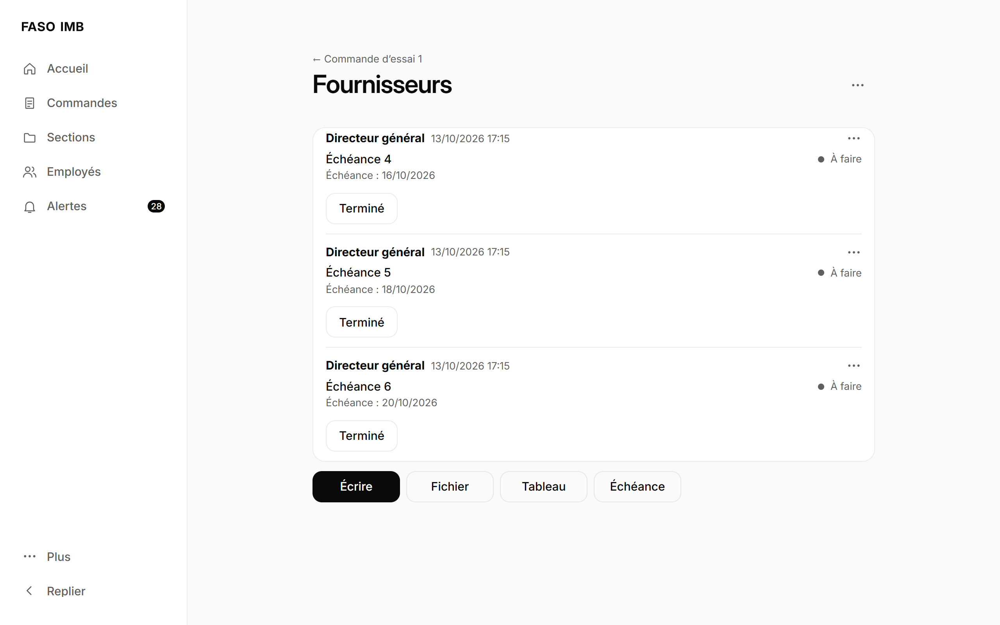

### Tasks (color-coded)
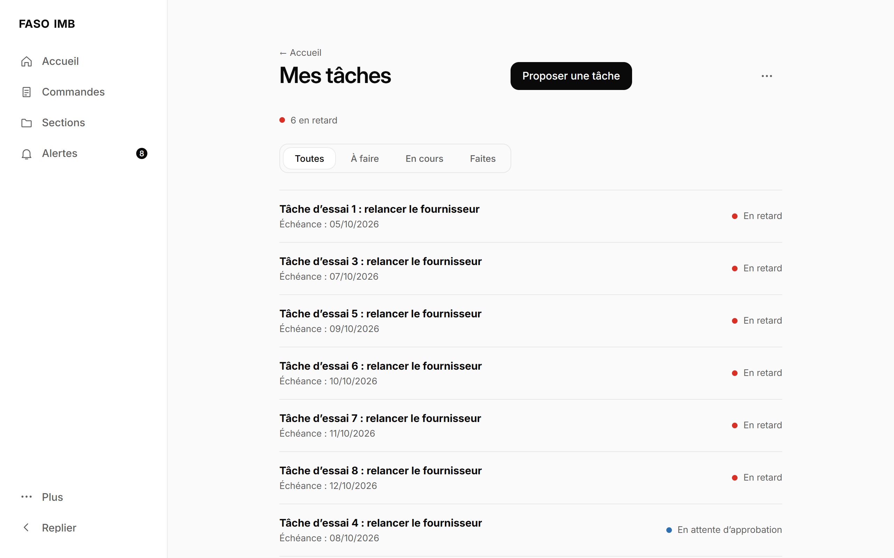

### Alerts and notifications
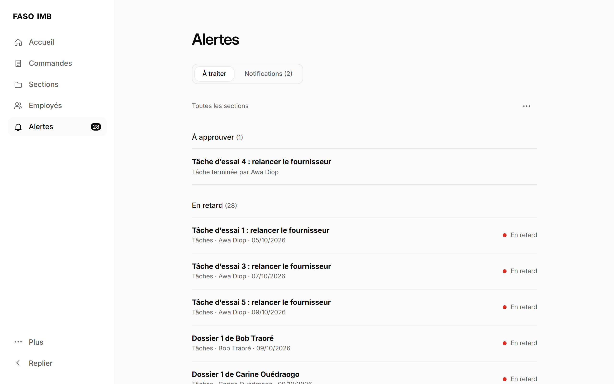

### Mobile view (responsive / PWA)

<p>
  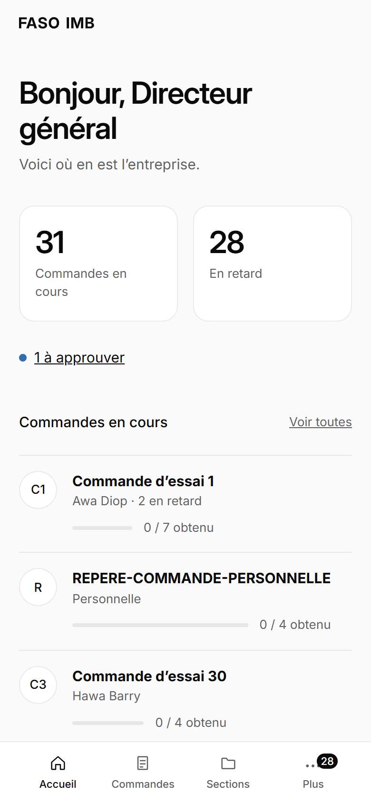
  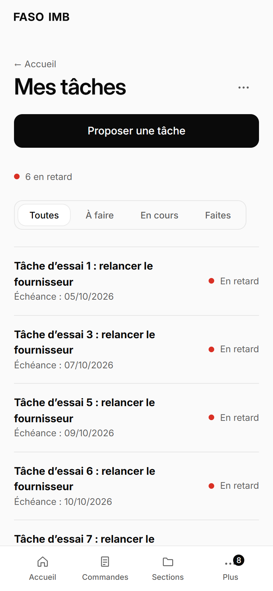
</p>

---

## Tech stack

| Layer | Technologies |
|-------|--------------|
| Frontend | React 19, TypeScript, Vite, React Router, PWA |
| Backend | Laravel 13 (PHP 8.3), Laravel Sanctum (token authentication) |
| Database | PostgreSQL |
| Documents | dompdf (PDF export), OpenSpout (Excel) |
| Quality | Oxlint, PHPUnit, Vitest, Playwright (end-to-end tests) |

---

## Architecture

```
            USERS
              |
              v
   RESPONSIVE WEB INTERFACE (PWA)
        React + TypeScript
              |  (REST API, token auth)
              v
        APPLICATION - Laravel
   +--------------------------------+
   | Authentication & permissions   |
   | Orders & protocol engine       |
   | Sections & activity feed       |
   | Tasks, proposals & work logs   |
   | Alerts & notifications         |
   | Audit log, PDF/Excel exports   |
   +--------------------------------+
              |
              v
          PostgreSQL
    + private document storage
```

---

## Security and privacy

Security is part of the design, not an afterthought:

- Individual accounts, with a forced password change on first login.
- All permissions are checked server-side — the interface never decides access on its own.
- An employee can never see or edit another employee's tasks or work log; these are filtered per user.
- Every important action is written to an audit log (author, date, old value to new value).
- Employee follow-up is personal-data processing: employees are informed and a retention period is defined, in line with local regulations.

The source code is kept private because the application runs for a real company. This repository is a showcase: it presents the work with no risk to the live application, and every screenshot uses demo data.

---

## Project status

In development — MVP in progress. The screens shown above are working. Production deployment will come later.

---

## Rights

Private project shown for portfolio purposes. All rights reserved. The application's source code, data and documents are not distributed.
